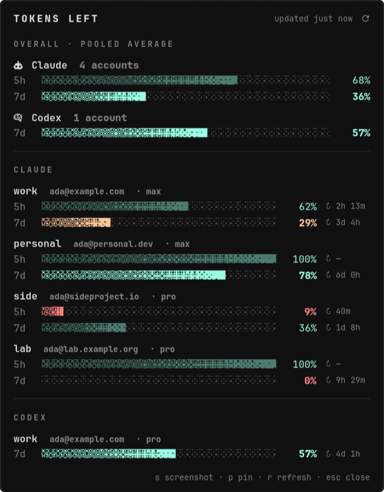

# how-many-tokens-left

A Waybar module that shows how much **5-hour** and **weekly** quota you have
left across every Claude and Codex account in
[CLIProxyAPI](https://github.com/router-for-me/CLIProxyAPI). It shows the same
data as `management.html#/quota`, without opening a browser.

```
 󰚩 5h 68% 7d 36%  │  󰧑 7d 57%
```

<p align="center"></p>

**Site:** https://claridgicus.github.io/how-many-tokens-left/

- **Bar:** pooled % left per provider. The smaller window (the one that
  will stop you first) is coloured and bold, and the other is dimmed.
- **Hover:** a tooltip with every account, a meter for each window, and the
  time until each window resets.
- **Click:** opens a dropdown panel under the module. It shows dithered
  progress bars for the overall pool per provider and for each account's
  5-hour and weekly windows, with reset countdowns. It updates live while
  open. Close it by clicking the module again, pressing Esc, or clicking
  elsewhere.
- **Right-click:** re-polls now. **Middle-click:** opens the quota dashboard.
- **Keys while the dropdown is focused:** `s` saves a screenshot of the panel
  to `~/Pictures` and copies it to the clipboard. `p` pins the panel so it
  stays open when focus moves, which lets region tools like `slurp` work.
  `r` refreshes, and `Esc` closes. From a terminal or keybind:
  `how-many-tokens-left screenshot [-o file.png]` and `popover --pin`.
- `how-many-tokens-left toggle` switches the bar itself to a per-account
  view (`󰚩 work 29% · personal 78% · …`), if you'd rather bind
  that to a click.

It polls every 5 minutes by default. It uses CLIProxyAPI's management
`api-call` proxy, so your OAuth tokens never leave the server. If a live
lookup fails (for example the upstream returns a 429), it falls back to the
rate-limit headers CLIProxyAPI recorded on its last request and marks the
account `(cached)`.

## Requirements

- Python ≥ 3.11 (stdlib only)
- A running CLIProxyAPI with `remote-management.secret-key` set
- Waybar (optional: `status` and `once` work anywhere)
- For the dropdown: `python-gobject`, `gtk4`, `gtk4-layer-shell`. The bar
  starts the panel in the background ahead of time, so clicks open it
  instantly (`[popover] preload`). Try it with fake data:
  `HMTL_DEMO=1 how-many-tokens-left popover`. The panel
  opens under your cursor on Hyprland. On other compositors it anchors to
  the top-right, and you can change that with `[popover] anchor`.

## Install

```sh
# Arch, from a checkout
makepkg -si

# or anywhere, as a symlink in ~/.local/bin
make install-user
```

## Configure

The tool needs your management key (the **plaintext** secret, not the hash
in `config.yaml`). It checks these places in order:

1. the `HMTL_MANAGEMENT_KEY` env var
2. `management_key` / `management_key_file` in `~/.config/how-many-tokens-left/config.toml`
3. `~/.config/how-many-tokens-left/management-key`
4. `~/.config/cliproxyapi/management-key.txt`

Check that it works:

```sh
how-many-tokens-left status          # coloured table
how-many-tokens-left status --json   # for scripts
```

For every option, see [`examples/config.toml`](examples/config.toml): URL,
interval, providers, pooling mode (`mean`/`min`/`sum`), thresholds, icons,
colours and per-email aliases.

## Waybar

Add `"custom/tokens"` to a modules array, then add this block:

```jsonc
"custom/tokens": {
    "exec": "how-many-tokens-left waybar",
    "return-type": "json",
    "format": "{}",
    "on-click": "how-many-tokens-left popover",
    "on-click-right": "how-many-tokens-left refresh",
    "on-click-middle": "how-many-tokens-left dashboard"
}
```

The module runs as one long-lived process. Don't set `interval` on it.
`toggle` and `refresh` send it `SIGUSR1` and `SIGUSR2` through pidfiles in
`$XDG_RUNTIME_DIR`. It caches the last result in
`~/.local/state/how-many-tokens-left/last.json`, so the bar shows numbers as
soon as Waybar starts.

CSS classes on `#custom-tokens`: `ok`, `warning`, `critical` (based on the
lowest pooled value), plus `error`, `stale` and `expanded`. `percentage` is
the lowest pooled value, if you want to use `format-icons`. See
[`examples/style.css`](examples/style.css).

## How the numbers are computed

For each account, *% left* = 100 − utilisation for each window. If an
account has no active 5-hour window, nothing has been used in it yet, so it
counts as 100%. The bar pools accounts per provider and per window:

| `aggregate` | meaning |
|---|---|
| `mean` (default) | average % left: your pool of capacity |
| `min` | the most-drained account |
| `sum` | total % left, e.g. `165%` ≈ 1.65 accounts' worth |

In the tooltip and the dropdown, each account's binding limit,
`min(5h, 7d)`, is drawn bright and bold, and its other window is dimmed.

The dropdown bars use ordered (Bayer 8×8) dithering. The fill goes from
sparse to solid towards its leading edge, and the empty track is a faint
dither. They're rendered at device pixels and scaled with nearest-neighbour
filtering, so they stay crisp under fractional scaling.

## Development

```sh
make test
how-many-tokens-left once | jq .
```

To add a provider, write a parser that returns `{"5h": Window, "7d": Window}`
and register it in `FETCHERS`.

## License

MIT
